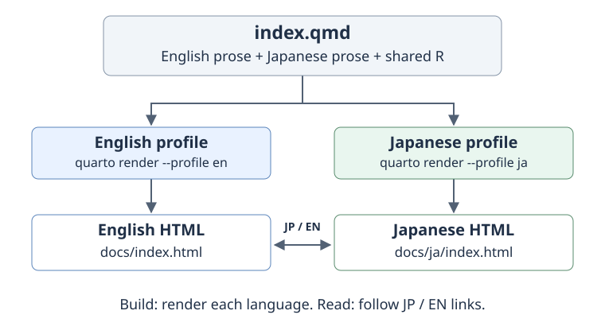
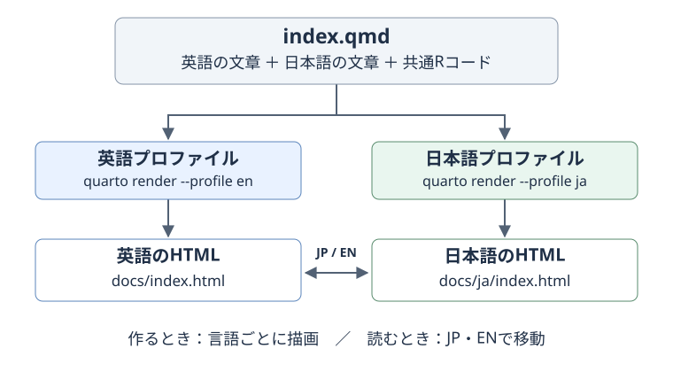

::::: {.content-visible unless-profile="ja"}

[日本語はこちら（JP）](../ja/notebooks/bilingual_quarto.html){#language-switch hreflang="ja" lang="ja"}

## What you will build

Keep English prose, Japanese prose and shared R code in **one source file per
page**. Build two sets of HTML, then link matching pages with JP/EN buttons.
Editing the calculation once updates both language versions on the next build.
Translations still need to be written and reviewed by a person.

This is the method used by this site and by
[leaf-mechanics-dehydration](https://github.com/maple60/leaf-mechanics-dehydration).
The diagram separates **building the site** from **reading the site**.



**When reading:** the browser opens an already built page. It does not run R,
render Quarto, or translate the page. Keep both language outputs available.

## Try a small project first

The following is a complete minimal example for a **new practice folder**.
It is not a replacement for this repository's climate-analysis configuration.
Install Quarto and, for the shared R example, R with `knitr` and `rmarkdown`.
This repository already manages its R packages with `renv`; use its usual
`renv::restore()` workflow instead of adding a second package setup.

Create this layout. `docs/` will be generated; do not write translations there.

:::::

::::: {.content-visible when-profile="ja"}

[Read this page in English (EN)](../../notebooks/bilingual_quarto.html){#language-switch hreflang="en" lang="en"}

## 何ができるようになるか

**1ページにつき1つのQMD**に、英語の文章、日本語の文章、共通のRコードを置きます。
そこから日英それぞれのHTMLを作り、JP／ENボタンで対応するページへ移動します。
計算を修正する場所は1か所で済み、次の描画で両言語に反映されます。
文章の翻訳と内容の照合は、人が行います。

このサイトと[leaf-mechanics-dehydration](https://github.com/maple60/leaf-mechanics-dehydration)で
採用した方法です。まず、**サイトを作る段階**と**読む段階**を分けて捉えると理解しやすくなります。



**読む段階では、作成済みの別ページを開くだけ**です。ブラウザーでRを実行したり、
Quartoを描画したり、自動翻訳したりするわけではありません。そのため、日英両方のHTMLを用意します。

## 小さな練習用プロジェクトを作る

以下は、**新しい練習用フォルダ**で動かす最小例です。
このリポジトリの気候解析設定を丸ごと置き換えるための設定ではありません。
Quartoを導入し、共通Rコードの実行例も試す場合はR・`knitr`・`rmarkdown`を用意します。
このリポジトリでは既存の`renv::restore()`を使い、別のパッケージ管理を追加する必要はありません。

次の構成にします。`docs/`は自動生成されるので、そこへ直接翻訳文を書かないでください。

:::::

```text
practice/
  _quarto.yml
  _quarto-en.yml
  _quarto-ja.yml
  index.qmd
  language-switch.html
  filters/
    language-title.lua
  docs/                       # generated / 自動生成
    index.html
    ja/
      index.html
```

::::: {.content-visible unless-profile="ja"}

### Step 1: Put shared settings in `_quarto.yml`

A *profile* is a named set of build settings. The group below makes `en` and
`ja` alternatives, with `en` as the default. The book chapters and formatting
are shared. The Japanese profile will override the output directory.

:::::

::::: {.content-visible when-profile="ja"}

### 手順1：共通設定を `_quarto.yml` に書く

「プロファイル」は、名前を付けた描画設定の組です。以下では`en`と`ja`を切り替える組にし、
先頭の`en`を標準にします。目次と見た目は共通にし、日本語版だけ出力先を上書きします。

:::::

```{.yaml filename="_quarto.yml"}
profile:
  group:
    - [en, ja]

project:
  type: book
  execute-dir: project
  output-dir: docs

book:
  title: "My bilingual notebook"
  chapters:
    - index.qmd

filters:
  - filters/language-title.lua

format:
  html:
    theme: cosmo
    include-after-body: language-switch.html
```

::::: {.content-visible unless-profile="ja"}

### Step 2: Add the two language profiles

`lang` selects Quarto's interface language, such as the table-of-contents label.
It does not translate your prose. Use separate output directories so the
Japanese build does not replace the English HTML.

The navbar links initially point to the home page. Step 5 will make them follow
the matching page when more chapters are added.

:::::

::::: {.content-visible when-profile="ja"}

### 手順2：言語別の設定ファイルを作る

`lang`は、目次などQuartoの表示言語を指定します。本文を翻訳する設定ではありません。
出力先を分けることで、日本語版の描画で英語HTMLが上書きされるのを防ぎます。

ナビゲーションのリンクは、最初はトップページへ向けます。
複数の章を追加したときも同じ章へ移動できるようにする仕組みは、手順5で加えます。

:::::

```{.yaml filename="_quarto-en.yml"}
lang: en

book:
  navbar:
    right:
      - text: "JP"
        href: ja/index.html
```

```{.yaml filename="_quarto-ja.yml"}
lang: ja

project:
  output-dir: docs/ja

book:
  title: "私の日英ノート"
  navbar:
    right:
      - text: "EN"
        href: ../index.html
```

::::: {.content-visible unless-profile="ja"}

### Step 3: Write both languages in `index.qmd`

`unless-profile="ja"` shows English when the Japanese profile is inactive;
`when-profile="ja"` shows Japanese when it is active. `::::` opens and closes
a language block. Keep these delimiters on their own lines, with blank lines
around them.

The executable R chunk is **outside both language blocks**. Both builds use
the same calculation, `mean(c(1, 2, 3))`, whose result is 2.
The `#language-switch` ID identifies the link used by the navbar script.
Only one such link should remain in each rendered page.

:::::

::::: {.content-visible when-profile="ja"}

### 手順3：1つの `index.qmd` に日英の文章を書く

`unless-profile="ja"`は日本語プロファイル以外で、`when-profile="ja"`は日本語プロファイルで
表示する文章です。`::::`でブロックを開閉します。区切りは独立した行に置き、前後に空行を入れます。

実行するRコードは、**両方の言語ブロックの外**へ置きます。
以下では、どちらの言語も同じ`mean(c(1, 2, 3))`を使い、結果は2です。
`#language-switch`は、後でナビゲーションの移動先を決めるための目印です。
描画された各ページに、この目印を持つリンクが1個だけ残るようにします。

:::::

````{.markdown filename="index.qmd"}
---
title: "A small calculation"
title-ja: "小さな計算例"
---

:::: {.content-visible unless-profile="ja"}

[日本語はこちら（JP）](ja/index.html){#language-switch hreflang="ja" lang="ja"}

## Mean of three numbers

We calculate the arithmetic mean of 1, 2 and 3.

::::

:::: {.content-visible when-profile="ja"}

[Read this page in English (EN)](../index.html){#language-switch hreflang="en" lang="en"}

## 3つの数の平均

1、2、3の算術平均を計算します。

::::

```{r}
#| label: shared-mean
mean(c(1, 2, 3))
```
````

::::: {.content-visible unless-profile="ja"}

::: {.callout-important title="Visibility and execution are different"}
Hiding a prose block is not an execution control. Do not put expensive or
data-reading R chunks inside the language blocks to prevent them from running.
Use chunk options such as `eval: false` to control execution explicitly.
Shared source code may still execute once **per language build**; sharing the
code does not guarantee that the computation runs only once in total.
:::

### Step 4: Select the translated page title with a small Lua filter

`title-ja` is our own metadata field. The filter below replaces `title` only
when `lang` is `ja`; it also supports an optional `subtitle-ja` field.
Lua is included with Quarto, so no additional R package is needed for this step.

:::::

::::: {.content-visible when-profile="ja"}

::: {.callout-important title="文章の表示とコードの実行は別です"}
文章を非表示にする設定は、コードの実行を止める設定ではありません。
重い処理やデータ読込を言語ブロックへ入れて、実行を回避しようとしないでください。
実行するかどうかは、チャンクの`eval: false`などで明示します。
共通コードであっても、通常は**言語ごとの描画でそれぞれ実行されます**。
コードを1つにすることと、計算回数が全体で1回になることは別です。
:::

### 手順4：小さなLuaフィルターでタイトルを切り替える

`title-ja`は、この方法で独自に設けたメタデータです。
次のフィルターは`lang`が`ja`のときだけ`title`を差し替えます。
任意の`subtitle-ja`による副題の切替にも対応しています。
LuaはQuartoに含まれているので、このためのRパッケージ追加は不要です。

:::::

```{.lua filename="filters/language-title.lua"}
function Meta(meta)
  if pandoc.utils.stringify(meta.lang) == "ja" then
    for _, field in ipairs({"title", "subtitle"}) do
      if meta[field .. "-ja"] then
        meta[field] = meta[field .. "-ja"]
      end
    end
  end
  return meta
end
```

::::: {.content-visible unless-profile="ja"}

### Step 5: Make the navbar switch to the same page

The page-level links already work without JavaScript. This script copies that
page's language link into the navbar, so switching from the ET0 chapter opens
the other ET0 chapter rather than returning to the home page.

Save it as `language-switch.html`, referenced by `include-after-body` in Step 1.
Keep the navbar labels exactly `JP` and `EN`, as those are the labels the
script looks for. A Japanese flag is optional: this site's
[language-switch.css](https://github.com/maple60/japanese-climate-calculation/blob/main/language-switch.css)
uses an embedded SVG, which avoids platform-dependent flag emoji rendering.
To reuse that decoration, copy the CSS file and add
`css: language-switch.css` under `format: html:` in the common configuration.

:::::

::::: {.content-visible when-profile="ja"}

### 手順5：ナビゲーションも同じページへ切り替える

ページ本文の言語リンクは、JavaScriptがなくても動きます。
次のスクリプトは、そのページの言語リンクをナビゲーションへ転記します。
そのため、ET₀章からJP／ENを押したときも、トップへ戻らず相手の言語のET₀章を開けます。

`language-switch.html`として保存します。手順1の`include-after-body`で読み込むファイルです。
スクリプトは`JP`と`EN`を探すので、ナビゲーションのラベルもこの表記に揃えます。
日の丸は任意です。このサイトの
[language-switch.css](https://github.com/maple60/japanese-climate-calculation/blob/main/language-switch.css)は、
環境によって表示が変わる旗の絵文字を避け、埋め込みSVGを使っています。
同じ見た目にする場合はCSSをコピーし、共通設定の`format: html:`に
`css: language-switch.css`を追加します。

:::::

```{.html filename="language-switch.html"}
<script>
document.addEventListener("DOMContentLoaded", () => {
  const target = document.querySelector("#language-switch");
  if (!target) return;
  for (const link of document.querySelectorAll(".navbar-nav .nav-link")) {
    if (["JP", "EN"].includes(link.textContent.trim())) {
      link.href = target.href;
      link.hreflang = target.hreflang;
      link.setAttribute("aria-label", target.textContent.trim());
    }
  }
});
</script>
```

::::: {.content-visible unless-profile="ja"}

### Step 6: Build both languages and check them in a browser

From the practice folder, run these commands **in order**. The small example
has no automatic post-render hook, so both commands are required.

:::::

::::: {.content-visible when-profile="ja"}

### 手順6：両言語を描画し、ブラウザーで確認する

練習用フォルダで、次のコマンドを**順番に**実行します。
最小例には自動描画のフックを付けていないので、2つとも必要です。

:::::

```bash
quarto render --profile en
quarto render --profile ja
quarto preview --profile en
```

::::: {.content-visible unless-profile="ja"}

Open the local address printed by `quarto preview`, then test the page link
and navbar switch in both directions. Both pages should show the number 2,
with their own title and explanatory text. If you edit the Japanese prose
afterward, rebuild the Japanese profile before checking it again.

For a chapter under `notebooks/`, use these relative links. A link is resolved
from the **generated HTML's directory**, not from the repository home page.
Here `example` is the name of your new chapter, not a page in this site.

| Page being read | Link to the other language |
|---|---|
| English home: `docs/index.html` | `ja/index.html` |
| Japanese home: `docs/ja/index.html` | `../index.html` |
| English chapter: `docs/notebooks/example.html` | `../ja/notebooks/example.html` |
| Japanese chapter: `docs/ja/notebooks/example.html` | `../../notebooks/example.html` |

### Step 7: Use the existing automation in this repository

This site adds a convenience layer to the minimal example:

1. `_quarto-en.yml` runs `scripts/render-japanese.R` after the English render.
2. The script builds Japanese pages when their sources have changed and keeps
   the English navigation index intact during the second build.
3. It also preserves the six old `*_ja.html` URLs with redirects and writes
   `.nojekyll` for GitHub Pages. These migration steps are specific to this site.

Therefore, **in this repository**, a normal `quarto render` builds both languages.
An explicit `quarto render --profile ja` builds Japanese only. Do not put the
Japanese post-render hook into `_quarto.yml` or `_quarto-ja.yml`: that could
trigger repeated rendering. The hook's paths and list of legacy URLs need
adjustment before copying it into a different project.

When adding a chapter here:

1. Create a single QMD with both prose blocks, shared code and both titles.
2. Add it to the appropriate chapter/appendix list in **both** profile files.
3. Add its filename to the `pages` list in `tests/check_bilingual.cjs`.
4. Run the build and link check below. Check the actual page switches in a browser.
5. Commit the source change and generated `docs/` together before publishing.

:::::

::::: {.content-visible when-profile="ja"}

`quarto preview`が表示したローカルURLを開き、本文リンクとナビゲーションの両方で往復します。
両ページで結果が2になり、タイトルと説明がそれぞれの言語になれば成功です。
その後に日本語の文章を編集した場合は、日本語プロファイルも再描画して確認します。

`notebooks/`に章を置く場合のリンクは次のとおりです。
リンクの基準は、リポジトリの入口ではなく**生成HTMLの置かれたフォルダ**です。
表の`example`は追加する章の仮名で、このサイトに実在するページではありません。

| 今開いているページ | 相手の言語へのリンク |
|---|---|
| 英語トップ：`docs/index.html` | `ja/index.html` |
| 日本語トップ：`docs/ja/index.html` | `../index.html` |
| 英語の章：`docs/notebooks/example.html` | `../ja/notebooks/example.html` |
| 日本語の章：`docs/ja/notebooks/example.html` | `../../notebooks/example.html` |

### 手順7：このリポジトリでは自動描画も利用する

このサイトでは、最小例に次の補助処理を加えています。

1. `_quarto-en.yml`から、英語の描画後に`scripts/render-japanese.R`を呼びます。
2. スクリプトは、ソースに変更があれば日本語版も描画し、その間は英語のナビゲーション索引を保護します。
3. 従来の6個の`*_ja.html`を新日本語ページへ転送し、GitHub Pages用の`.nojekyll`も作ります。
   この移行処理は、このサイト固有のものです。

したがって、**このリポジトリでは**`quarto render`だけで両言語を作れます。
日本語だけなら`quarto render --profile ja`です。
日本語を呼ぶフックを共通設定や日本語設定にも書くと、描画の繰り返しを招くので避けます。
別プロジェクトへコピーする場合は、スクリプト内のフォルダ名や旧URL一覧を合わせて変更してください。

ここへ新しい章を追加するときの順序は、次のとおりです。

1. 日英の文章、共通コード、両言語のタイトルを持つQMDを1つ作ります。
2. **両方**のプロファイルの目次・付録へ追加します。
3. `tests/check_bilingual.cjs`の`pages`一覧へファイル名を追加します。
4. 下のコマンドで描画・リンク検査を行い、ブラウザーでも言語切替を試します。
5. 公開する際は、ソースの変更と生成された`docs/`を揃えてコミットします。

:::::

```bash
quarto render
node tests/check_bilingual.cjs
```

::::: {.content-visible unless-profile="ja"}

## Files to refer to while editing

| File in this repository | Purpose |
|---|---|
| [`_quarto.yml`](https://github.com/maple60/japanese-climate-calculation/blob/main/_quarto.yml) | Shared book, resources and format settings |
| [`_quarto-en.yml`](https://github.com/maple60/japanese-climate-calculation/blob/main/_quarto-en.yml) / [`_quarto-ja.yml`](https://github.com/maple60/japanese-climate-calculation/blob/main/_quarto-ja.yml) | Language, navigation and output paths |
| [`calculate_ET0.qmd`](https://github.com/maple60/japanese-climate-calculation/blob/main/notebooks/calculate_ET0.qmd) | A real example of shared calculations and bilingual explanations |
| [`language-title.lua`](https://github.com/maple60/japanese-climate-calculation/blob/main/filters/language-title.lua) | Japanese title/subtitle selection |
| [`language-switch.html`](https://github.com/maple60/japanese-climate-calculation/blob/main/language-switch.html) | Match the navbar link to the current page |
| [`render-japanese.R`](https://github.com/maple60/japanese-climate-calculation/blob/main/scripts/render-japanese.R) | Automatic second render and legacy URL redirects |

## If something does not work

| Symptom | Check |
|---|---|
| Both languages appear in the body | The `content-visible` attributes, profile name, closing colons and blank lines |
| Japanese prose appears under an English title | `title-ja`, the Lua filter path and `lang: ja` |
| JP/EN always returns to the home page | The page-level `#language-switch` link and loaded navbar script |
| The other language gives a 404 | Both builds exist, relative paths are correct, and both output trees were published |
| The Japanese page is out of date | The Japanese profile was rebuilt after the edit |
| A hidden chunk still reads data | Visibility is separate from execution; explicitly set `eval: false` |
| Editing `docs/*.html` has no lasting effect | Edit the QMD/configuration instead, then render |

For GitHub Pages, a successful push is not the same as a successful deployment.
Check the deployment for the pushed commit, then open both public language URLs.
Publish from a completed, verified build; do not publish a folder while it is
being rendered. Climate-data sharing restrictions still apply independently
of the language-switching mechanism.

## Official references

The underlying Quarto features are [Project Profiles](https://quarto.org/docs/projects/profiles.html)
and [Conditional Content](https://quarto.org/docs/authoring/conditional.html).
The title filter, navbar script and automatic second render are this project's
small additions to those features.

:::::

::::: {.content-visible when-profile="ja"}

## 編集しながら参照するファイル

| このリポジトリのファイル | 役割 |
|---|---|
| [`_quarto.yml`](https://github.com/maple60/japanese-climate-calculation/blob/main/_quarto.yml) | サイト全体・配布資源・見た目の共通設定 |
| [`_quarto-en.yml`](https://github.com/maple60/japanese-climate-calculation/blob/main/_quarto-en.yml) / [`_quarto-ja.yml`](https://github.com/maple60/japanese-climate-calculation/blob/main/_quarto-ja.yml) | 言語・目次・出力先 |
| [`calculate_ET0.qmd`](https://github.com/maple60/japanese-climate-calculation/blob/main/notebooks/calculate_ET0.qmd) | 計算を共有して説明を切り替える実例 |
| [`language-title.lua`](https://github.com/maple60/japanese-climate-calculation/blob/main/filters/language-title.lua) | 日本語タイトル・副題の選択 |
| [`language-switch.html`](https://github.com/maple60/japanese-climate-calculation/blob/main/language-switch.html) | ナビゲーションを現在のページに対応させる処理 |
| [`render-japanese.R`](https://github.com/maple60/japanese-climate-calculation/blob/main/scripts/render-japanese.R) | 日本語版の自動描画と旧URL転送 |

## うまく動かないとき

| 症状 | 確認するところ |
|---|---|
| 本文に両方の言語が出る | `content-visible`の属性、プロファイル名、閉じるコロン、前後の空行 |
| 本文は日本語なのにタイトルが英語 | `title-ja`、Luaファイルへのパス、`lang: ja` |
| JP／ENで毎回トップへ戻る | 本文の`#language-switch`リンクと、スクリプトの読込 |
| 相手の言語が404になる | 両言語のHTMLが存在するか、相対パス、両方の公開先への配置 |
| 日本語版だけ古い | 編集後に日本語プロファイルも再描画したか |
| 非表示のコードがデータを読む | 表示と実行は別なので、必要なら`eval: false`を明記 |
| `docs/*.html`を直しても元に戻る | QMD・設定を編集してから再描画する |

GitHub Pagesでは、pushの成功とデプロイの成功は別です。
pushしたコミットのデプロイ結果を確認し、公開された日英両方のURLを開きます。
描画中のフォルダを公開せず、完成して検証した出力を使ってください。
気象データの外部共有条件は、言語切替の仕組みとは別に守る必要があります。

## 公式資料

基盤となる機能は、Quartoの[Project Profiles](https://quarto.org/docs/projects/profiles.html)と
[Conditional Content](https://quarto.org/docs/authoring/conditional.html)です。
タイトル用Lua、ナビゲーション用JavaScript、日本語版の自動描画は、これらへこのプロジェクトで
追加した小さな補助処理です。

:::::
