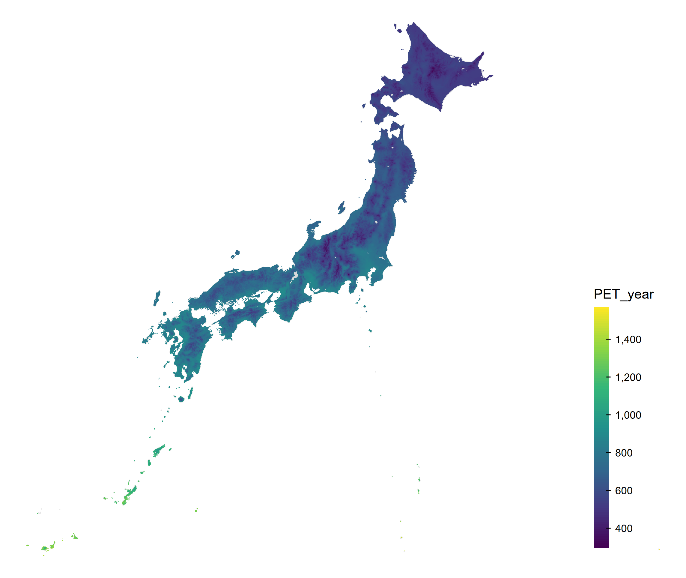
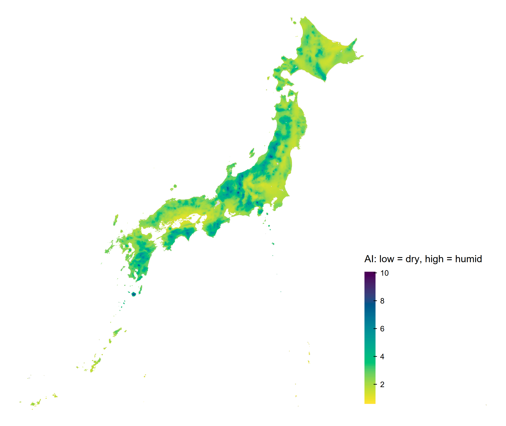

::::: {.content-visible unless-profile="ja"}

[日本語はこちら（JP）](../ja/notebooks/plot_japan_climate_map.html){#language-switch hreflang="ja" lang="ja"}

:::::

::::: {.content-visible when-profile="ja"}

[Read this page in English (EN)](../../notebooks/plot_japan_climate_map.html){#language-switch hreflang="en" lang="en"}

:::::

::::: {.content-visible unless-profile="ja"}

This chapter draws Japan climate maps using [tmap](https://r-tmap.github.io/tmap/index.html) and [rnaturalearth](https://docs.ropensci.org/rnaturalearth/articles/rnaturalearth.html).

:::::

::::: {.content-visible when-profile="ja"}

[tmap](https://r-tmap.github.io/tmap/index.html)パッケージを使用して、日本の気候マップを描画します。
[rnaturalearth](https://docs.ropensci.org/rnaturalearth/articles/rnaturalearth.html)パッケージは、日本地図を描画するために使用します。

:::::

```{r}
library(tmap)
library(rnaturalearth)
```

::::: {.content-visible unless-profile="ja"}

## Load data

:::::

::::: {.content-visible when-profile="ja"}

## データの読み込み

このリポジトリの解析では、環境変数 `PROJECT_DATA_DIR` にデータの保存先を指定しています。
必要に応じて、適宜変更してください。

:::::

```{r}
data_dir <- Sys.getenv("PROJECT_DATA_DIR")
sf_climate <- readRDS(file.path(
  data_dir,
  "climate_mesh_data_joined/climate_mesh_data_with_aridity_index.rds"
))
```

::::: {.content-visible unless-profile="ja"}

## Plot PET

:::::

::::: {.content-visible when-profile="ja"}

## Evapotranspiration (PET)の描画

日本地図を描画するには、[rnaturalearthhiresパッケージ](https://github.com/ropensci/rnaturalearthhires)が必要です。

tmapの描画は、[ggplot2](https://ggplot2.tidyverse.org/)の描画のように、レイヤを重ねる形で行います。
まず、日本地図を描画し、その上に気候変数を描画します。
その後、レイアウトを調整して完成です。

保存したい場合は、`tm`オブジェクトを`tmap_save()`関数に渡すことで、描画を保存できます。

:::::

```{r}
# renv::install("ropensci/rnaturalearthhires")
variable <- "PET_year"
japan <- ne_states(country = "Japan", returnclass = "sf")
sf_plot <- sf_climate[!is.na(sf_climate[[variable]]), ]
tm <- tm_shape(japan, crs = 4612) +
  tm_polygons(col = "gray90") +
  tm_shape(sf_plot[, variable], crs = 4612) +
  tm_fill(
    fill = variable,
    fill.scale = tm_scale_continuous(values = "viridis"),
    fill.legend = tm_legend(
      title = variable,
      reverse = TRUE,
      position = c("right", "bottom"),
      frame = FALSE,
      bg.color = "transparent"
    )
  ) +
  tm_layout(frame = FALSE, bg.color = "transparent")
print(tm)

output_dir <- "output"
dir.create(output_dir, showWarnings = FALSE, recursive = TRUE)
tmap_save(
  tm,
  filename = file.path(
    output_dir,
    paste0("japan_climate_map_", variable, ".png")
  ),
  dpi = 300
)
```

::::: {.content-visible unless-profile="ja"}



## Plot Aridity Index

:::::

::::: {.content-visible when-profile="ja"}

結果は以下のようになります。


::: {.callout-note}
## 描画関数

- `tm_polygons()`は、ポリゴンを描画するための関数です。境界線と塗りつぶしの両方を描画します。
- `tm_fill()`は、塗りつぶしのみを描画するための関数です。境界線は描画しません。
- `tm_borders()`は、境界線のみを描画するための関数です。塗りつぶしは描画しません。

今回のようにポリゴンが小さく、多い場合は、境界線を書いてしまうと塗りつぶしが見えなくなってしまうことがあります。
そのため、今回は`tm_fill()`を使用して、塗りつぶしのみを描画します。
:::

## Aridity Indexの描画

次に、Aridity Indexを描画します。

:::::

```{r}
variable <- "aridity_index"
japan <- ne_states(country = "Japan", returnclass = "sf")
sf_plot <- sf_climate[!is.na(sf_climate[[variable]]), ]
tm <- tm_shape(japan, crs = 4612) +
  tm_polygons(col = "gray90") +
  tm_shape(sf_plot[, variable], crs = 4612) +
  tm_fill(
    fill = variable,
    # Low AI (drier) is yellow; high AI (wetter) is purple.
    fill.scale = tm_scale_continuous(values = hcl.colors(100, "Viridis", rev = TRUE)),
    fill.legend = tm_legend(
      title = "AI: low = dry, high = humid",
      reverse = TRUE,
      position = c("right", "bottom"),
      frame = FALSE,
      bg.color = "transparent"
    )
  ) +
  tm_layout(frame = FALSE, bg.color = "transparent")
print(tm)

tmap_save(
  tm,
  filename = file.path(
    output_dir,
    paste0("japan_climate_map_", variable, ".png")
  ),
  dpi = 300
)
```

::::: {.content-visible unless-profile="ja"}



Yellow indicates lower AI (drier conditions); purple indicates higher AI (wetter conditions).

### Plot monthly Aridity Index

The same map can be drawn for each monthly AI column. Run the loop to save one PNG per month.

:::::

::::: {.content-visible when-profile="ja"}

結果は以下のようになります。


黄色ほどAIが小さく乾燥側、紫色ほどAIが大きく湿潤側を表します。

### 月ごとのAridity Indexの描画

月ごとのAridity Indexも同様に描画できます。

:::::

```{r}
japan <- ne_states(country = "Japan", returnclass = "sf")
month_labels <- month.abb
for (month in seq_along(month_labels)) {
  month_label <- month_labels[month]
  variable <- paste0("aridity_index_", month_label)
  sf_plot <- sf_climate[!is.na(sf_climate[[variable]]), ]
  tm <- tm_shape(japan, crs = 4612) +
    tm_polygons(col = "gray90") +
    tm_shape(sf_plot[, variable], crs = 4612) +
    tm_fill(
      fill = variable,
      fill.scale = tm_scale_continuous(
        values = hcl.colors(100, "Viridis", rev = TRUE)
      ),
      fill.legend = tm_legend(
        title = paste0(variable, ": low = dry, high = humid"),
        reverse = TRUE,
        position = c("right", "bottom"),
        frame = FALSE,
        bg.color = "transparent"
      )
    ) +
    tm_layout(
      frame = FALSE,
      bg.color = "transparent"
    )
  print(tm)

  tmap_save(
    tm,
    filename = file.path(
      output_dir,
      paste0("japan_climate_map_", variable, ".png")
    ),
    dpi = 300
  )
}
```

::::: {.content-visible when-profile="ja"}

実行すると、各月の地図がPNG形式で保存されます。

:::::
